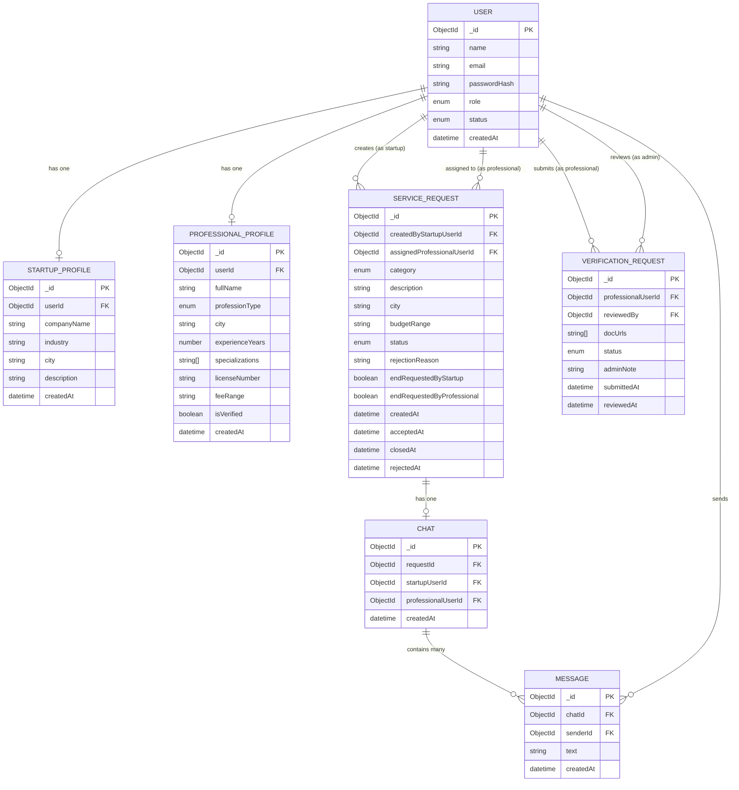

# VOUCH — A MOBILE PLATFORM FOR CONNECTING STARTUPS WITH VERIFIED LEGAL AND FINANCIAL PROFESSIONALS

---

**Student Name:** [Your Name]
**Enrollment Number:** [Your Enrollment Number]
**Course:** Bachelor of Computer Application (BCA)
**Supervisor Name:** [Supervisor Name]
**Department:** Computer Science & Engineering
**School:** School of Engineering Sciences & Technology, Jamia Hamdard, New Delhi
**Year:** 2026

---

---

## 1. TITLE

**Vouch: A Mobile Application for Connecting Startups with Verified Lawyers and Chartered Accountants**

---

## 2. OBJECTIVE

The primary objectives of the Vouch application are:

1. To provide a trusted, verified directory of Lawyers and Chartered Accountants (CAs) accessible to startup founders through a mobile application.

2. To enable startups to raise categorized service requests (legal or financial) with relevant details such as budget, city, and service type so that professionals can evaluate fit before accepting.

3. To automate the professional verification process through an admin-controlled document review workflow, ensuring only qualified professionals appear in the directory.

4. To facilitate direct, real-time communication between a startup and its assigned professional through an in-app chat system, reducing dependence on external messaging platforms.

5. To enforce structured service lifecycle management — from request creation through acceptance, active engagement, and mutually confirmed closure — so that both parties have clarity on the status of work at all times.

6. To implement secure, token-based authentication with access and refresh token rotation to protect user data and sessions.

---

## 3. INTRODUCTION

The modern startup ecosystem in India is growing rapidly. Early-stage and mid-stage startups regularly require professional legal and financial services — company incorporation, trademark registration, contract review, tax filing, compliance management, and litigation support. However, finding a reliable and qualified professional is a significant challenge. Existing approaches include personal referrals, unverified online directories, and general-purpose freelancing platforms, all of which suffer from lack of trust, poor communication, and misaligned expectations.

**Vouch** is a mobile application built using React Native (frontend) and Node.js with Express.js (backend) that addresses this gap. The application supports three user roles:

- **Startup:** A company or founder seeking legal or CA services. They can browse the professional directory, filter by city and type, view detailed profiles, raise service requests, chat with an assigned professional, and track request history.

- **Lawyer / CA (Professional):** A verified legal or financial professional. They can view open service requests that match their profession type, accept or reject requests with a reason, communicate with the startup through in-app chat, and manage their active and completed jobs.

- **Admin:** A platform administrator who reviews professional verification documents uploaded by Lawyers and CAs and approves or rejects them. Only admin-approved professionals appear as verified in the directory.

The application is built as a full-stack mobile project with a RESTful backend API, real-time WebSocket-based chat, cloud-based document storage, and a secure JWT authentication mechanism with automatic token refresh. The mobile frontend is built with React Native for cross-platform compatibility on Android and iOS devices.

Key features of the system include:

- Verified professional directory with city and profession-type filtering
- Categorized service requests: Lawyer categories (Contract Review, Trademark, Litigation, IP Protection, Due Diligence) and CA categories (Company Incorporation, Tax Filing, Compliance, Other)
- Per-type blocking: a startup can have one active Lawyer request and one active CA request simultaneously but not two of the same type
- Mutual end-of-service confirmation: both the startup and the professional must confirm before a request is marked closed
- Real-time in-app chat powered by Socket.IO, automatically created when a professional accepts a request
- Admin dashboard for professional verification management
- Secure password hashing (bcrypt, 12 rounds) and JWT-based access/refresh token lifecycle

---

## 4. PROBLEM STATEMENT

Startups in India face the following specific problems when seeking legal and financial professional services:

**4.1 Lack of Trustworthy Discovery**
There is no dedicated platform where a startup can find verified, qualified lawyers and CAs. General directories do not validate credentials or qualifications. Word-of-mouth referrals are limited and slow.

**4.2 Mismatch in Expectations**
When a startup contacts a professional without structured information, there is often a mismatch in service type, budget, city, and availability. This leads to wasted time on both sides.

**4.3 Fragmented Communication**
Communication with professionals happens across multiple channels — phone calls, WhatsApp, email — with no formal record of the work agreement or conversation tied to the specific service request.

**4.4 No Lifecycle Management**
There is no system to track the status of a professional engagement from request creation to completion. Startups have no visibility into whether a request is open, accepted, or closed.

**4.5 No Verification Mechanism**
There is no lightweight mechanism for a platform to verify professional credentials (bar council registration, CA membership, etc.) before listing them publicly.

**Proposed Solution:**
Vouch addresses all of the above by providing:
- A verified professional directory (admin reviews uploaded documents before a professional is marked verified)
- Structured service requests with category, description, city, and budget
- An in-app real-time chat tied directly to each service engagement
- A clear request lifecycle: OPEN → ACCEPTED → CLOSED (or REJECTED)
- Role-based access controls ensuring each user sees only what is relevant to them

---

## 5. SYSTEM REQUIREMENT SPECIFICATION (SRS)

### 5.1 Functional Requirements

**5.1.1 User Registration and Authentication**
- The system shall allow users to register with a name, email, password, and role (STARTUP, LAWYER, or CA).
- The system shall validate email format and enforce a minimum password strength (at least 8 characters, containing both letters and numbers).
- The system shall authenticate users using JSON Web Tokens (JWT) with a short-lived access token (15 minutes) and a long-lived refresh token (7 days).
- The system shall automatically refresh the access token using the refresh token without requiring the user to log in again.
- The system shall allow an Admin account to be seeded separately via a script.

**5.1.2 Professional Profile Management**
- A Lawyer or CA shall be able to create and update their profile containing full name, profession type, city, years of experience, specializations, license number, and fee range.
- A professional shall be able to upload verification documents (1 to 3 files) to the platform.
- An Admin shall be able to review, approve, or reject professional verification submissions with an optional note.
- The system shall mark a professional's profile as verified only upon admin approval.

**5.1.3 Startup Profile Management**
- A Startup user shall be able to create and update their profile containing company name, industry, city, and a brief description.

**5.1.4 Professional Directory**
- Any authenticated user shall be able to browse a paginated directory of professionals.
- The directory shall support filtering by city, profession type (LAWYER or CA), and verified status.

**5.1.5 Service Request Management**
- A Startup shall be able to create a service request with category, description, city, and budget range.
- The system shall enforce per-type blocking: a startup may not create a second active Lawyer request if one is already OPEN or ACCEPTED; the same rule applies independently for CA requests.
- A Lawyer or CA shall be able to view open requests relevant to their profession type.
- A professional shall be able to accept or reject a request. Rejection shall require a reason.
- A startup shall be able to cancel an OPEN request.
- For ACCEPTED requests, the system shall support a mutual end-of-service mechanism: both the startup and the professional must request to end the service before the status changes to CLOSED.

**5.1.6 Chat and Messaging**
- The system shall automatically create a chat conversation when a professional accepts a service request.
- Both the startup and the professional shall be able to exchange real-time text messages within the chat.
- Messages shall be persisted in the database and retrievable in paginated form.
- The system shall use WebSocket (Socket.IO) for real-time message delivery.

**5.1.7 Admin Panel**
- The Admin shall be able to view all pending professional verification requests.
- The Admin shall be able to approve or reject a verification request with an optional note.
- Upon approval, the professional's `isVerified` flag shall be set to true.

### 5.2 Non-Functional Requirements

**5.2.1 Security**
- All passwords shall be stored as bcrypt hashes with a cost factor of 12.
- All API endpoints except registration, login, and token refresh shall require a valid JWT.
- Role-based access control shall be enforced via middleware on every protected route.
- Authentication endpoints shall be rate-limited to prevent brute-force attacks (10 requests per minute per IP).
- HTTP security headers shall be applied using the Helmet middleware.

**5.2.2 Performance**
- The backend API shall respond to standard read requests within 500 milliseconds under normal load.
- The MongoDB collections shall have appropriate indexes (e.g., `{ status, city }` for service requests, `{ chatId, createdAt }` for messages) to support efficient queries.
- The professional directory shall support pagination to avoid large data transfers.

**5.2.3 Scalability**
- The backend shall be stateless (no server-side session storage) to allow horizontal scaling.
- The application shall be containerized using Docker for consistent deployment.

**5.2.4 Usability**
- The mobile application shall support both Android and iOS platforms.
- The UI shall be clean, light-themed, and follow standard mobile design patterns.
- Form validation errors shall be shown inline with descriptive messages.

**5.2.5 Reliability**
- Failed API requests due to expired access tokens shall be automatically retried after a token refresh, with no user interruption.
- All unhandled errors shall be caught by a global error handler middleware and returned as structured JSON responses.

### 5.3 Hardware Requirements

| Component | Minimum Requirement |
|---|---|
| Mobile Device | Android 8.0 (API 26) or iOS 13 and above |
| Server (Backend) | 1 vCPU, 1 GB RAM (development); 2 vCPU, 2 GB RAM (production) |
| Storage | 10 GB for application and logs; document files stored on Cloudinary (cloud) |

### 5.4 Software Requirements

| Component | Technology / Version |
|---|---|
| Mobile Frontend | React Native 0.84.1, TypeScript 5.x |
| Backend Framework | Node.js 20.x, Express.js 4.19 |
| Database | MongoDB 7.x (MongoDB Atlas or local) |
| ORM / ODM | Mongoose 8.5 |
| Real-time Communication | Socket.IO 4.7 |
| Authentication | JSON Web Tokens (JWT), bcryptjs |
| File Storage | Cloudinary |
| State Management (Frontend) | Redux Toolkit 2.11, TanStack Query 5.95 |
| HTTP Client | Axios 1.14 |
| Form Validation | React Hook Form 7.72, Zod |
| Secure Token Storage | react-native-keychain |
| Build Tools | Android SDK 36, JDK 17, Gradle 8.13, Metro Bundler |
| Development OS | Windows / macOS / Linux |

### 5.5 System Architecture Overview

The system follows a three-tier client-server architecture:

- **Presentation Layer:** React Native mobile application running on the user's device. Communicates with the backend over HTTPS (REST) and WebSocket.
- **Application Layer:** Node.js / Express.js backend server. Handles all business logic, authentication, request processing, and real-time events through Socket.IO.
- **Data Layer:** MongoDB database for persistent storage; Cloudinary for professional verification document file storage.

---

## 6. DATA FLOW DIAGRAMS (DFD)

A Data Flow Diagram (DFD) represents how data moves through the Vouch system — from external actors, through processing steps, to data stores and back. Processes are shown as circles, external entities as rectangles, data stores as open-ended rectangles, and data flows as labelled arrows.

---

### 6.1 Level 0 — Context Diagram

The Level 0 DFD represents the entire Vouch system as a single process. It shows all external entities that interact with the system and the data that flows between them.

```
  ┌──────────────┐                                        ┌──────────────┐
  │              │── Registration / Login ──────────────► │              │
  │   STARTUP    │── Startup Profile Data ───────────────►│              │
  │    USER      │── Service Request Details ────────────►│              │
  │              │── End-Service Confirmation ───────────►│              │
  │              │── Chat Messages ───────────────────────►              │
  │              │◄─ Auth Tokens ─────────────────────────│              │
  │              │◄─ Professional Directory ──────────────│              │
  │              │◄─ Request Status & History ────────────│   V O U C H  │
  │              │◄─ Chat Messages ───────────────────────│              │
  └──────────────┘                                        │    S Y S T E M│
                                                          │              │
  ┌──────────────┐                                        │   (Central   │
  │ PROFESSIONAL │── Registration / Login ───────────────►│   Process)   │
  │ (LAWYER/CA)  │── Professional Profile & Docs ────────►│              │
  │              │── Accept / Reject Decision ───────────►│              │
  │              │── End-Service Confirmation ───────────►│              │
  │              │── Chat Messages ───────────────────────►              │
  │              │◄─ Auth Tokens ─────────────────────────│              │
  │              │◄─ Open Service Requests ───────────────│              │
  │              │◄─ Job Status & History ────────────────│              │
  │              │◄─ Chat Messages ───────────────────────│              │
  └──────────────┘                                        │              │
                                                          │              │
  ┌──────────────┐                                        │              │
  │    ADMIN     │── Login ──────────────────────────────►│              │
  │    USER      │── Approve / Reject + Note ────────────►│              │
  │              │◄─ Auth Tokens ─────────────────────────│              │
  │              │◄─ Pending Verification List ───────────│              │
  └──────────────┘                                        │              │
                                                          │              │
  ┌──────────────┐                                        │              │
  │  CLOUDINARY  │◄─ Verification Document Files ─────────│              │
  │  (External   │── Document Storage URLs ──────────────►│              │
  │   Storage)   │                                        │              │
  └──────────────┘                                        └──────────────┘
```

---

### 6.2 Level 1 DFD

The Level 1 DFD decomposes the Vouch system into five major sub-processes, each representing a core functional module. Data stores shared between processes are shown.

```
  EXTERNAL ENTITIES                  PROCESSES                     DATA STORES
  ─────────────────                  ─────────────────────────     ────────────────────

  ┌───────────┐    Registration   ┌──────────────────────────┐
  │  STARTUP  │──────────────────►│  1.0                     │──── Write ──► D1: USERS
  │    USER   │   Login / Token   │  AUTHENTICATE &          │
  │           │◄──────────────────│  MANAGE PROFILES         │──── Write ──► D2: STARTUP_PROFILES
  │           │   Profile Data    │                          │
  └───────────┘──────────────────►└──────────────────────────┘
        │                                    ▲
        │                                    │ Registration / Login
        │                              ┌─────┴────────────────────┐
  ┌─────┴─────┐                        │  PROFESSIONAL /          │──── Write ──► D3: PROFESSIONAL_PROFILES
  │PROFESSIONAL│──────────────────────►│  ADMIN USER              │
  │ (LWR / CA) │   Profile & Docs      │  (same process 1.0)      │
  │           │                        └──────────────────────────┘
  │    ADMIN  │
  └───────────┘

  ┌───────────┐    Browse Request  ┌──────────────────────────┐
  │  STARTUP  │──────────────────►│  2.0                     │──── Read ───► D3: PROFESSIONAL_PROFILES
  │    USER   │◄──────────────────│  MANAGE PROFESSIONAL     │
  │           │   Directory List   │  DIRECTORY               │
  └───────────┘                   └──────────────────────────┘

  ┌───────────┐    Create Request  ┌──────────────────────────┐
  │  STARTUP  │──────────────────►│  3.0                     │──── Write ──► D4: SERVICE_REQUESTS
  │    USER   │◄──────────────────│  MANAGE SERVICE          │◄─── Read ───  D4: SERVICE_REQUESTS
  │           │   Status Updates   │  REQUESTS                │
  │           │                   │                          │──── Read ───► D1: USERS
  ├───────────┤   Open Jobs List  │                          │
  │PROFESSIONAL│──────────────────►│                          │
  │           │◄──────────────────│                          │
  │           │  Accept/Reject     │                          │
  └───────────┘  End-Service      └──────────────────────────┘

  ┌───────────┐    Send Message   ┌──────────────────────────┐
  │  STARTUP  │──────────────────►│  4.0                     │──── Write ──► D5: CHATS
  │    USER   │◄──────────────────│  MANAGE CHAT &           │──── Write ──► D6: MESSAGES
  │           │  Messages (RT)    │  MESSAGING               │◄─── Read ───  D4: SERVICE_REQUESTS
  ├───────────┤                   │  (Socket.IO)             │
  │PROFESSIONAL│──────────────────►│                          │
  │           │◄──────────────────└──────────────────────────┘
  └───────────┘

  ┌───────────┐   Submit Docs     ┌──────────────────────────┐
  │PROFESSIONAL│──────────────────►│  5.0                     │──── Write ──► D7: VERIFICATION_REQUESTS
  │           │                   │  MANAGE                  │────────────►  CLOUDINARY (file upload)
  ├───────────┤   Approve/Reject  │  VERIFICATION            │
  │   ADMIN   │──────────────────►│  (ADMIN)                 │──── Update ─► D3: PROFESSIONAL_PROFILES
  │           │◄──────────────────│                          │    (isVerified flag)
  │           │   Pending List    │                          │
  └───────────┘                   └──────────────────────────┘


  DATA STORES
  ───────────────────────────────────────────────────────────────
  D1  USERS                —  User accounts (all roles)
  D2  STARTUP_PROFILES     —  Company details for startup users
  D3  PROFESSIONAL_PROFILES—  Profile, city, type, verified flag
  D4  SERVICE_REQUESTS     —  Request lifecycle data
  D5  CHATS               —  Chat room per accepted request
  D6  MESSAGES            —  Individual chat messages
  D7  VERIFICATION_REQUESTS—  Submitted documents + review status
```

---

### 6.3 Level 2 DFD — Process 3.0: Manage Service Requests

This diagram expands Process 3.0 to show the internal sub-processes of the service request lifecycle.

```
                     ┌─────────────────────────────────────────────────────────────┐
                     │                 3.0  MANAGE SERVICE REQUESTS                │
                     │                                                             │
  ┌──────────┐       │  ┌───────────────────────────────────────────────────────┐  │
  │ STARTUP  │──────────► 3.1 CREATE REQUEST                                    │  │
  │   USER   │  Cat, │  │ • Validate category, description, city, budget        │  │
  │          │  Desc,│  │ • Check: active LAWYER request exists? (per-type      │  │
  │          │  City,│  │   block applies only to same professional type)        │  │
  │          │  Budg │  │ • Write new request (status = OPEN)                   │  │──► D4: SERVICE_REQUESTS
  │          │       │  └───────────────────────────────────────────────────────┘  │
  │          │       │                                                             │
  │          │       │  ┌───────────────────────────────────────────────────────┐  │
  │          │◄─────────│ 3.2 VIEW MY REQUESTS                                  │  │
  │          │  List │  │ • Query D4 by createdByStartupUserId                  │  │◄── D4: SERVICE_REQUESTS
  │          │       │  │ • Enrich ACCEPTED records with professional details   │  │◄── D3: PROFESSIONAL_PROFILES
  │          │       │  │ • Group by: Lawyer / CA / Other sections              │  │
  │          │       │  └───────────────────────────────────────────────────────┘  │
  │          │       │                                                             │
  │          │       │  ┌───────────────────────────────────────────────────────┐  │
  │          │──────────► 3.5 CANCEL REQUEST                                    │  │
  │          │  Cancel  │ • Allowed only if status = OPEN                       │  │──► D4: SERVICE_REQUESTS
  └──────────┘       │  │ • Updates status → CLOSED                             │  │    (status = CLOSED)
                     │  └───────────────────────────────────────────────────────┘  │
                     │                                                             │
  ┌──────────┐       │  ┌───────────────────────────────────────────────────────┐  │
  │PROFESSIONAL│─────────► 3.3 VIEW OPEN REQUESTS                               │  │
  │(LWR / CA)│  Query│  │ • Filter D4: status = OPEN                            │  │◄── D4: SERVICE_REQUESTS
  │          │       │  │ • Match profession type to request category            │  │◄── D2: STARTUP_PROFILES
  │          │◄─────────│ • Enrich with startup company name                    │  │
  │          │  List │  └───────────────────────────────────────────────────────┘  │
  │          │       │                                                             │
  │          │       │  ┌───────────────────────────────────────────────────────┐  │
  │          │──────────► 3.4 ACCEPT / REJECT REQUEST                           │  │
  │          │  Decision │ • ACCEPT: status → ACCEPTED, assign professional     │  │──► D4: SERVICE_REQUESTS
  │          │  + Reason │           auto-create Chat record                    │  │──► D5: CHATS (created)
  │          │       │  │ • REJECT: status → REJECTED, store rejectionReason   │  │
  │          │       │  └───────────────────────────────────────────────────────┘  │
  │          │       │                                                             │
  │          │       │  ┌───────────────────────────────────────────────────────┐  │
  │  STARTUP │──────────► 3.6 REQUEST END SERVICE (Mutual Confirmation)         │  │
  │    OR    │  End  │  │ • Set endRequestedByStartup = true  (if startup)       │  │──► D4: SERVICE_REQUESTS
  │PROFESSIONAL│ Request  │ • Set endRequestedByProfessional = true (if pro)    │  │    (flag updates)
  │          │◄─────────│ • If BOTH flags true → status = CLOSED, closedAt set │  │
  └──────────┘  Status  └───────────────────────────────────────────────────────┘  │
                     └─────────────────────────────────────────────────────────────┘
```

---

### 6.4 Level 2 DFD — Process 4.0: Manage Chat & Messaging

```
                     ┌─────────────────────────────────────────────────────────────┐
                     │                 4.0  MANAGE CHAT & MESSAGING                │
                     │                                                             │
  ┌──────────┐       │  ┌───────────────────────────────────────────────────────┐  │
  │  SYSTEM  │       │  │ 4.1 INITIATE CHAT                                     │  │
  │ (Auto-   │──────────► • Triggered automatically on request ACCEPT            │  │──► D5: CHATS
  │ trigger) │       │  │ • Creates Chat { requestId, startupId, professionalId }│  │
  └──────────┘       │  │ • Uses upsert — no duplicate chats if re-triggered    │  │
                     │  └───────────────────────────────────────────────────────┘  │
                     │                                                             │
  ┌──────────┐       │  ┌───────────────────────────────────────────────────────┐  │
  │ STARTUP  │──────────► 4.2 SEND MESSAGE                                      │  │
  │    OR    │  Text │  │ • Validate sender is a participant in the chat         │  │──► D6: MESSAGES
  │PROFESSIONAL│     │  │ • Persist Message { chatId, senderId, text, createdAt }│  │
  │          │       │  │ • Emit via Socket.IO to room = chatId                 │  │
  └──────────┘       │  └───────────────────────────────────────────────────────┘  │
                     │                                                             │
  ┌──────────┐       │  ┌───────────────────────────────────────────────────────┐  │
  │ STARTUP  │       │  │ 4.3 RECEIVE MESSAGE (Real-Time)                       │  │
  │    OR    │◄─────────│ • Socket.IO pushes message to all clients in room     │◄── D6: MESSAGES
  │PROFESSIONAL│  RT │  │ • Client appends message to local chat state          │  │
  │          │ Push  │  └───────────────────────────────────────────────────────┘  │
  └──────────┘       │                                                             │
                     │  ┌───────────────────────────────────────────────────────┐  │
  ┌──────────┐       │  │ 4.4 FETCH MESSAGE HISTORY                             │  │
  │ STARTUP  │──────────► • Query D6: messages for chatId, sorted by createdAt  │  │◄── D6: MESSAGES
  │    OR    │  chatId  │ • Paginated: page + limit parameters                  │  │
  │PROFESSIONAL│◄─────────│ • Returns array of messages with senderIds           │  │
  └──────────┘  History  └───────────────────────────────────────────────────────┘  │
                     └─────────────────────────────────────────────────────────────┘
```

---

## 7. ENTITY RELATIONSHIP (ER) DIAGRAM

The following diagram shows all seven entities in the Vouch database, their attributes, and the relationships between them.

### 7.1 ER Diagram — Mermaid Notation

*(This diagram renders in VS Code with the Markdown Preview Mermaid Support extension, and on draw.io / Lucidchart by importing the Mermaid code.)*



---

### 7.2 ER Diagram — Textual Description

For reference and manual redrawing in tools such as draw.io or Microsoft Visio:

| Entity | Primary Key | Foreign Keys | Cardinality Notes |
|---|---|---|---|
| USER | _id | — | Root entity; every system user has exactly one User document |
| STARTUP_PROFILE | _id | userId → USER | One-to-one with USER (only STARTUP role) |
| PROFESSIONAL_PROFILE | _id | userId → USER | One-to-one with USER (LAWYER or CA role only) |
| SERVICE_REQUEST | _id | createdByStartupUserId → USER; assignedProfessionalUserId → USER | Many-to-one from startup; Many-to-one to professional |
| CHAT | _id | requestId → SERVICE_REQUEST; startupUserId → USER; professionalUserId → USER | One-to-one with SERVICE_REQUEST |
| MESSAGE | _id | chatId → CHAT; senderId → USER | Many-to-one with CHAT |
| VERIFICATION_REQUEST | _id | professionalUserId → USER; reviewedBy → USER | Many-to-one from professional; reviewed by admin |

**Key Relationships:**
- A `USER` with role STARTUP has exactly one `STARTUP_PROFILE` (created during onboarding).
- A `USER` with role LAWYER or CA has exactly one `PROFESSIONAL_PROFILE`.
- A `STARTUP` USER can create many `SERVICE_REQUEST` records, but at most one active LAWYER request and one active CA request at any time (enforced at application layer).
- Each `SERVICE_REQUEST` when ACCEPTED gets exactly one `CHAT` (created automatically).
- A `CHAT` contains many `MESSAGE` records; each message references the sender via `senderId`.
- A `PROFESSIONAL` USER submits `VERIFICATION_REQUEST` records with document URLs; an `ADMIN` USER reviews them.

---

## 8. SNAPSHOTS

*(Snapshots of the application screens will be inserted here. Below is a structured list of screens to be captured.)*

### 8.1 Authentication Flow
- **Screen 1:** Landing Screen — light theme, Sign In form (email + password), Create Account button
- **Screen 2:** Create Account Screen — role selector (Startup / Lawyer / CA), form fields, password eye toggle

### 8.2 Startup User Flow
- **Screen 3:** Professional Directory — list of verified professionals with city and profession-type filters
- **Screen 4:** Professional Detail Screen — full profile: name, type, city, experience, specializations, fee range, Create Request button
- **Screen 5:** New Service Request Screen — category picker (Lawyer / CA sections), description, city, budget
- **Screen 6:** My Requests Screen — SectionList with Lawyer Requests and CA Requests sections; OPEN, ACCEPTED, CLOSED, REJECTED status badges
- **Screen 7:** ACCEPTED Request Card — assigned professional info, Open Chat button, End Service button
- **Screen 8:** Chat Screen — real-time conversation between startup and professional

### 8.3 Professional User Flow
- **Screen 9:** Open Requests Screen — paginated list of open jobs relevant to the professional's type
- **Screen 10:** Request Detail — Accept / Reject with reason option
- **Screen 11:** My Jobs Screen — Active Jobs and History sections; mutual end-service confirmation UI
- **Screen 12:** Verification Upload Screen — document picker, submit for admin review

### 8.4 Admin Flow
- **Screen 13:** Verifications List — pending professional verification submissions
- **Screen 14:** Approve / Reject Screen — document preview links, admin note input, action buttons

---

## 9. CONCLUSION

Vouch successfully demonstrates how a mobile application can solve a real-world trust and discovery problem in the professional services domain. The application provides a complete, end-to-end workflow — from user registration and professional verification to service request lifecycle management and real-time in-app communication.

The project was developed using modern, industry-standard technologies: React Native for the cross-platform mobile frontend, Node.js and Express.js for the RESTful backend, MongoDB for flexible document-oriented storage, and Socket.IO for real-time messaging. The implementation follows best practices in API design, security (JWT with refresh token rotation, bcrypt password hashing, Helmet headers, rate limiting), and frontend state management (Redux for authentication, TanStack Query for server state).

The three-role architecture — Startup, Professional (Lawyer/CA), and Admin — cleanly separates concerns and provides each user type with a focused, relevant interface. The admin verification workflow ensures that only credentialed professionals are listed in the directory, which is the core trust guarantee of the platform.

The mutual end-of-service mechanism, per-type request blocking, and structured service categories add meaningful business logic that reflects real-world requirements. The project, while a prototype, is structured and architected in a manner that supports production deployment and future scaling.

In conclusion, Vouch addresses a genuine gap in the startup ecosystem by combining a verified directory, structured service requests, and an integrated communication channel into a single mobile platform.

---

## 10. LIMITATIONS

The following limitations exist in the current version of the application:

1. **No Payment Integration:** The platform facilitates discovery and communication but does not handle payments. Fee negotiation and payment happen outside the app. A complete solution would include an integrated payment gateway.

2. **Manual Admin Verification:** Document verification is performed manually by an admin. There is no automated identity verification (e.g., integration with bar council APIs or CA Institute APIs) to validate credentials programmatically.

3. **No Push Notifications:** The application does not send push notifications (e.g., when a professional accepts a request or sends a message). Users must open the app to see updates. Real-time awareness is limited to when the app is open and connected.

4. **Text-Only Chat:** The in-app chat supports only text messages. Professionals and startups cannot share documents, images, or contracts directly within the chat.

5. **No Rating or Review System:** After a service is completed, there is no mechanism for startups to rate or review professionals. This limits the platform's ability to build a reputation layer over time.

6. **Single Device Session:** The current JWT implementation does not maintain a device token registry, meaning there is no per-device session management or the ability to log out of a specific device remotely.

7. **No Search in Chat:** Chat history is paginated but not searchable. In long engagements, finding a specific message requires scrolling through history.

8. **Android Primary, iOS Secondary:** The application was primarily developed and tested on Android emulators. While React Native supports iOS, full iOS testing and App Store deployment were not completed within the project scope.

---

## 11. FUTURE SCOPE

The following enhancements are planned or recommended for future versions of Vouch:

1. **Payment Gateway Integration:** Integration with Razorpay or Stripe to allow startups to pay professionals directly through the app, with invoice generation and payment history.

2. **Automated Credential Verification:** Integration with official APIs (Bar Council of India, Institute of Chartered Accountants of India) or third-party KYC providers to automate the professional verification process.

3. **Push Notifications:** Integration with Firebase Cloud Messaging (FCM) to send real-time push notifications for key events — new message received, request accepted, end-of-service requested, etc.

4. **Rich Media in Chat:** Support for sharing documents (PDF contracts, incorporation certificates) and images directly within the chat conversation.

5. **Ratings and Reviews:** A post-service rating system (1–5 stars with optional text review) for startups to evaluate professionals. Aggregate ratings would be displayed on professional profile cards in the directory.

6. **AI-Powered Professional Matching:** Based on a startup's service request category, city, and budget, the system could proactively suggest the top 3–5 matching professionals rather than requiring the startup to browse manually.

7. **Video/Audio Consultation:** Integration of WebRTC-based video or audio calling within the app for initial consultations before formally creating a service request.

8. **Web Dashboard for Professionals:** A companion web application for professionals to manage their profile, track requests, respond to messages, and view earnings — without needing a mobile device.

9. **Multi-Language Support:** Internationalization (i18n) to support regional Indian languages, making the platform accessible to professionals and startups in non-English-dominant regions.

10. **Analytics Dashboard for Admin:** An admin analytics panel showing platform metrics — number of registered professionals by city and type, request volumes, average time to acceptance, and completion rates — to support platform growth decisions.

---

## 12. BIBLIOGRAPHY

1. Pressman, R. S., & Maxim, B. R. (2014). *Software Engineering: A Practitioner's Approach* (8th ed.). McGraw-Hill Education.

2. Sommerville, I. (2016). *Software Engineering* (10th ed.). Pearson Education.

3. MongoDB, Inc. (2024). *MongoDB Manual*. Retrieved from https://www.mongodb.com/docs/manual/

4. OpenJS Foundation. (2024). *Node.js Documentation*. Retrieved from https://nodejs.org/en/docs/

5. Express.js Team. (2024). *Express.js API Reference*. Retrieved from https://expressjs.com/en/4x/api.html

6. Meta Open Source. (2024). *React Native Documentation*. Retrieved from https://reactnative.dev/docs/getting-started

7. React Navigation Contributors. (2024). *React Navigation Documentation*. Retrieved from https://reactnavigation.org/docs/getting-started

8. Socket.IO Team. (2024). *Socket.IO Documentation*. Retrieved from https://socket.io/docs/v4/

9. Auth0. (2024). *JSON Web Tokens (JWT) Introduction*. Retrieved from https://jwt.io/introduction

10. OWASP Foundation. (2024). *OWASP Top Ten — Web Application Security Risks*. Retrieved from https://owasp.org/www-project-top-ten/

11. TanStack. (2024). *TanStack Query (React Query) Documentation*. Retrieved from https://tanstack.com/query/latest/docs/framework/react/overview

12. Redux Team. (2024). *Redux Toolkit Documentation*. Retrieved from https://redux-toolkit.js.org/introduction/getting-started

13. Cloudinary. (2024). *Cloudinary Node.js SDK Documentation*. Retrieved from https://cloudinary.com/documentation/node_integration

14. Silberschatz, A., Korth, H. F., & Sudarshan, S. (2019). *Database System Concepts* (7th ed.). McGraw-Hill Education.

15. Fowler, M. (2018). *Refactoring: Improving the Design of Existing Code* (2nd ed.). Addison-Wesley Professional.

---

*End of Report*
